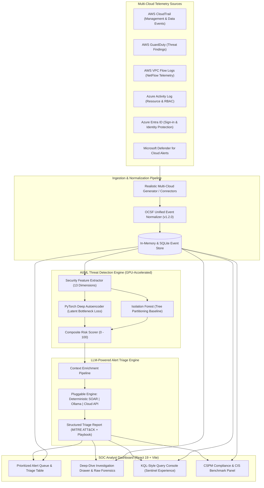

# CloudSentry AI: Multi-Cloud AI-Powered SOC Threat Detection & Alert Triage Platform

[](https://python.org)
[](https://fastapi.tiangolo.com)
[](https://react.dev)
[](https://ocsf.io)
[](LICENSE)

**CloudSentry AI** is an enterprise-grade, portfolio-ready Security Operations Center (SOC) threat detection and incident triage platform. It ingests and normalizes multi-cloud security telemetry from **AWS** and **Azure**, detects subtle non-linear behavioral anomalies using a **GPU-accelerated PyTorch Deep Autoencoder** (benchmarked against an **Isolation Forest**), and leverages a **pluggable LLM triage engine** to auto-generate plain-English incident summaries, exact **MITRE ATT&CK** mappings, and immediate tactical containment playbooks.

It also features an interactive **KQL query console** (mimicking Azure Sentinel) and real-time **Cloud Security Posture Management (CSPM)** checks aligned with CIS Benchmarks.

---

## Architecture Overview



---

## Key Technical Components

### 1. Multi-Cloud Ingestion & OCSF Normalization
- **Solves SIEM Vendor Lock-In**: Maps disparate telemetry into Open Cybersecurity Schema Framework (**OCSF v1.2.0**) objects (`UnifiedOCSFEvent`).
- **Telemetry Covered**:
  - **AWS**: CloudTrail (Management & Data Events), GuardDuty findings, VPC Flow Logs (NetFlow v2).
  - **Azure**: Monitor Activity Log, Microsoft Entra ID Sign-ins, Microsoft Defender for Cloud alerts.
- **Why Synthetic Dataset?**: Real production audit logs contain sensitive company PII, customer secrets, and internal IP ranges that cannot be shared in portfolio repositories. The built-in generator creates authentic AWS/Azure JSON payloads with realistic background enterprise activity (~95%) and deliberate adversary attack patterns (~5%).
- **Live Ingestion Ready**: Includes live connector interfaces (`AWSCloudTrailConnector` via SQS/S3, `AzureEventHubConnector` via Event Hub).

### 2. AI/ML Threat Detection Engine (GPU-Accelerated with CPU Fallback)
- **PyTorch Deep Autoencoder**: Unsupervised neural network with bottleneck latent layer ($z \in \mathbb{R}^6$) trained on normal baseline telemetry. Reconstruction Mean Squared Error (MSE) correlates directly with novel zero-day attack behavior.
- **Isolation Forest Baseline**: Scikit-learn tree-partitioning algorithm for benchmarking non-linear neural performance against classic tabular anomaly detection.
- **Composite Defense-in-Depth Scoring**:
  $$\text{Risk Score} = 0.50 \times \text{Autoencoder} + 0.15 \times \text{Isolation Forest} + 0.35 \times \text{Rule Heuristics}$$
  A signature-based floor guarantees that critical indicators (e.g. AdministratorAccess attachment or Tor exit nodes) are never diluted.

### 3. LLM-Powered SOC Alert Triage Engine
- **Solves Alert Fatigue**: For each flagged anomaly, auto-generates:
  - **Executive Summary**: Plain-English incident briefing explaining identity, action, asset, and threat impact.
  - **MITRE ATT&CK Alignment**: Tactics, Technique IDs (e.g., `T1078.004`, `T1098`, `T1530`, `T1071`), sub-techniques, and direct links to the MITRE knowledge base.
  - **Containment Playbook**: Ordered mitigation steps with exact ready-to-run AWS CLI and Azure CLI commands.
- **Pluggable Architecture**:
  - **Mode 1 (Default / Zero-Config)**: Deterministic SOC Expert Knowledge Engine based on NIST SP 800-61 (100% offline, zero latency, zero cost, zero hallucinations).
  - **Mode 2 (Local LLM)**: Connects to local Ollama (`llama3:8b` or `phi3:mini`) for private, on-premise GPU inference.
  - **Mode 3 (Cloud API)**: Connects to Groq, OpenAI, or Gemini via `.env`.

### 4. Interactive SOC Analyst Dashboard (React 19)
- **Live Alert Queue**: Filterable by Cloud (AWS/Azure), Severity (Critical/High/Medium/Low), and Status (New/Investigating/Contained/Resolved), sorted by risk score.
- **Deep-Dive Investigation Drawer**:
  - Executive summary & MITRE ATT&CK badges.
  - Interactive containment checklist with 1-click **Copy Command** buttons.
  - Blast radius analysis (correlated events within ±60 minutes).
  - Syntax-highlighted OCSF and raw native JSON inspectors.
- **KQL Query Console**: Mimics Microsoft Sentinel / Log Analytics with support for `where`, `project`, `sort by`, and `take` operations.
- **CSPM Panel**: Real-time CIS Benchmark checks evaluating storage encryption, IAM wildcard permissions, and management port exposures.

### 5. Injected Attack Scenarios (MITRE ATT&CK Mapped)
1. **Impossible Travel & Tor Exit Login**: Legitimate login from Seattle, followed 15 minutes later by a rogue login from Frankfurt via a Tor exit node (`T1078.004`, `T1535`).
2. **AWS IAM Privilege Escalation**: Compromised service account attaching `AdministratorAccess` to an inactive identity and creating a backdoor access key (`T1098`, `T1078.004`).
3. **S3 Ransomware & Data Exfiltration**: Rapid bulk download of financial archives followed by a `PutBucketPolicy` lockout (`T1530`, `T1485`).
4. **VPC Flow C2 Beaconing**: Internal host transmitting periodic 320-byte heartbeats to external C2 IP on port 4444 (`T1071`, `T1571`).
5. **Azure RBAC Backdoor**: Compromised admin assigning root subscription "Owner" role to an external guest identity (`T1098.003`).

---

## Project Structure

```
cloudsentry-ai/
├── backend/
│   ├── app/
│   │   ├── api/                 # REST endpoints, KQL engine, CSPM checks
│   │   ├── detection/           # PyTorch Autoencoder, Isolation Forest, Feature Extractor
│   │   ├── ingestion/           # OCSF Normalizer, AWS/Azure parsers, Attack generator
│   │   ├── schemas/             # OCSF v1.2.0, Raw telemetry, Triage Pydantic models
│   │   ├── triage/              # LLM client & deterministic expert playbooks
│   │   └── main.py              # FastAPI server & lifespan state manager
│   ├── tests/                   # 20 comprehensive unit & integration tests
│   ├── Dockerfile               # Production container definition
│   └── requirements.txt         # Python dependencies
├── frontend/
│   ├── src/
│   │   ├── components/          # Navbar, StatsBar, AlertQueue, Drawer, KQL, CSPM
│   │   ├── App.jsx              # Master application controller
│   │   └── index.css            # Custom dark cybersecurity SOC theme
│   ├── Dockerfile               # Multi-stage Vite + Nginx container
│   └── package.json
├── infra/
│   └── terraform/
│       ├── aws/main.tf          # CloudTrail, S3 PAB, SQS DLQ, Least-privilege IAM, GuardDuty
│       └── azure/main.tf        # Event Hub stream, Log Analytics, Activity Log diagnostics
├── data/samples/                # Generated multi-cloud sample datasets
├── docker-compose.yml           # Full-stack container orchestration
├── INTERVIEW_NOTES.md           # Master technical interview defense cheat sheet
└── README.md
```

---

## Quickstart Guide

### Prerequisites
- **Python**: 3.11+ (tested on Python 3.13)
- **Node.js**: 18+ (tested on Node.js 24)
- **Git**

### 1. Run Automated Test Suite
```bash
cd backend
$env:PYTHONPATH="." # PowerShell (or export PYTHONPATH=. on Linux/macOS)
python -m pytest tests -v
```
*Expected: 20 passed tests covering normalization, ML detection, triage, and API endpoints.*

### 2. Start Backend API
```bash
cd backend
$env:PYTHONPATH="."
python -m uvicorn app.main:app --host 127.0.0.1 --port 8000 --reload
```
*API Swagger Documentation is available at: [http://localhost:8000/docs](http://localhost:8000/docs)*

### 3. Start Frontend Dashboard
```bash
cd frontend
npm install
npm run dev
```
*Dashboard will launch at: [http://localhost:5173](http://localhost:5173)*

### 4. Run via Docker Compose (Optional)
```bash
docker-compose up --build
```
- Frontend: [http://localhost:3000](http://localhost:3000)
- Backend API: [http://localhost:8000](http://localhost:8000)

---

## Interview Defense Guide
See [`INTERVIEW_NOTES.md`](./INTERVIEW_NOTES.md) for a comprehensive, plain-English breakdown of every technical decision (Autoencoder vs. Isolation Forest, AWS vs. Azure logging nuances, OCSF normalization, and 50,000 EPS enterprise scaling).
